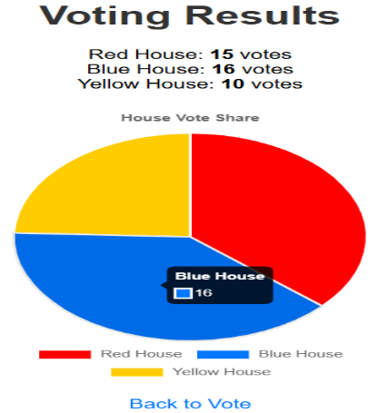

# Online Voting System

A simple web-based voting app built during my Web Development internship at CodeBind Technologies (16 June 2025 – 16 July 2025).

## Features

- Select a house (Red, Blue, Green, Yellow) and cast a vote
- Live vote count list
- Pie chart of the results
- Clear all votes

## Technologies

- HTML, CSS (Tailwind CSS)
- JavaScript
- Chart.js

Votes are stored in the browser's `localStorage`.

## Run

Open `index.html` in any web browser.
